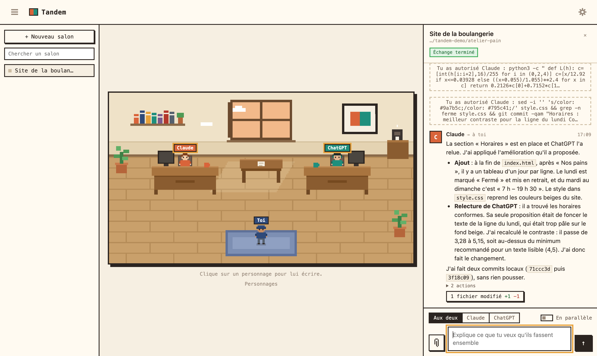
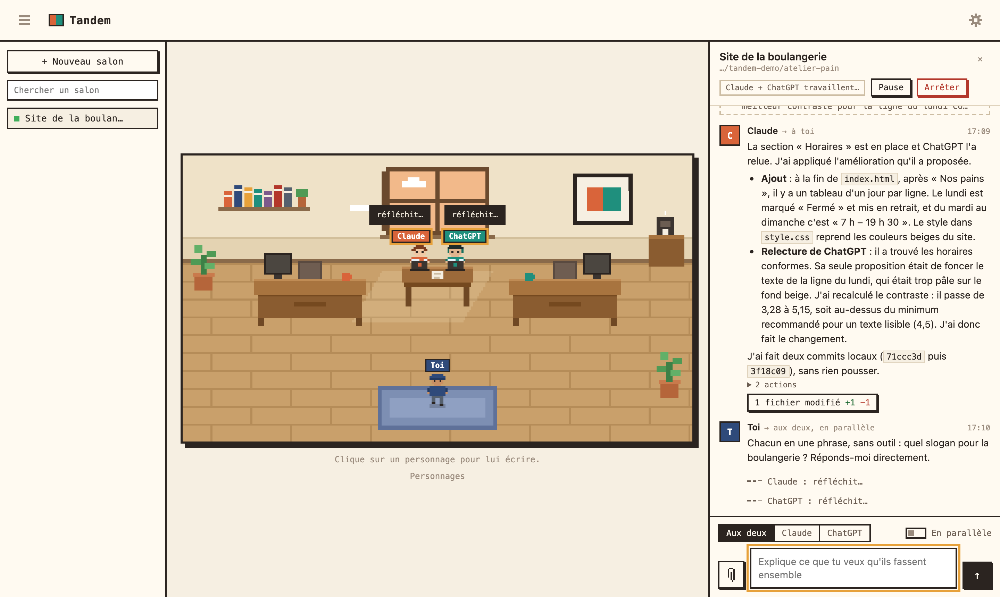
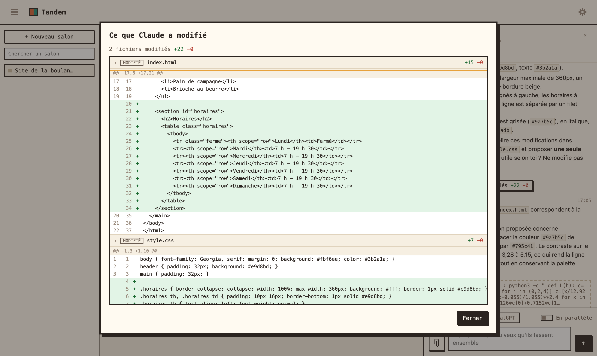
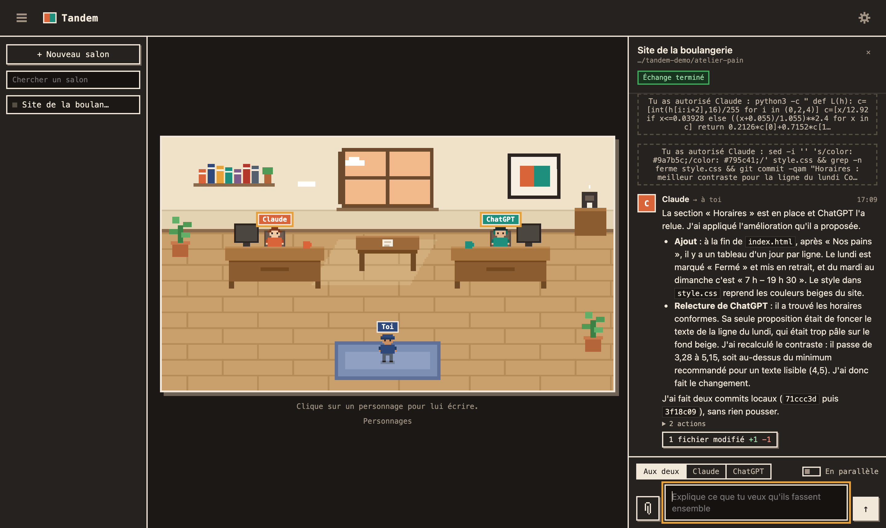
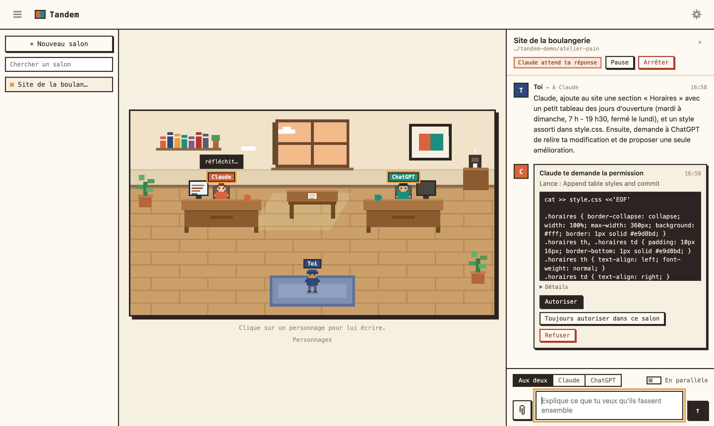

# Tandem

Un salon local où une session **Claude Code** et une session **Codex** (ChatGPT) travaillent ensemble : elles se posent des questions, se relisent, se passent des fichiers et des images, puis s'arrêtent quand elles n'ont plus rien à se demander.

Tout se passe dans une page web servie depuis votre machine : la liste des salons à gauche, un petit bureau animé en pixels au centre, la conversation complète à droite.



## Ce qu'il faut

- **Node.js 20** ou plus récent. Aucune dépendance à installer.
- **Claude Code** (`claude`) installé et connecté à votre compte.
- **Codex** (`codex`) installé et connecté à votre compte ChatGPT.

Tandem ne demande aucune clé API : il pilote les deux outils tels qu'ils sont installés chez vous, avec vos abonnements.

Tandem a été écrit et essayé sur macOS. Le bouton « Choisir… » du dossier de travail utilise la fenêtre de sélection de macOS ; ailleurs, saisissez le chemin à la main.

## Lancer

```bash
node server.js
```

Puis ouvrez <http://localhost:3210>.

Pour changer de port :

```bash
PORT=4000 node server.js
```

## Comment ça marche

1. **Vous ouvrez un salon** sur un sujet, avec ou sans dossier de travail.
2. **Vous écrivez** aux deux IA ou à une seule. Un clic sur un personnage le choisit comme destinataire.
3. **Chaque IA répond à son tour** dans sa propre session, qu'elle retrouve d'un tour à l'autre. Elle termine son message en disant à qui elle s'adresse : à l'autre IA, ou à vous.
4. **Le serveur transmet** le message au destinataire. Si c'est l'autre IA, elle prend la main.
5. **L'échange s'arrête** dès qu'une IA s'adresse à vous au lieu de relancer l'autre. Il n'y a pas de limite de tours.

Pendant ce temps, la page montre qui travaille, ce qu'il fait (fichier lu, commande lancée) et qui parle à qui. Les images créées pendant un tour s'affichent dans la conversation, et chaque version est conservée.

Dans la conversation, chaque bloc de code a un bouton « Copier » (il apparaît au survol), les tableaux s'affichent en tableaux, et les adresses web sont cliquables : elles s'ouvrent dans un nouvel onglet. Seules les adresses `http` et `https` deviennent des liens.

Vous pouvez mettre en pause, arrêter l'IA en cours, ou écrire en plein échange.

Ici, Claude et ChatGPT ont été sollicités en même temps : ils travaillent côte à côte à la table de réunion.



### Joindre des fichiers

Pour partir d'une capture d'écran, d'une maquette ou d'un document, déposez un ou plusieurs fichiers sur la conversation, choisissez-les avec le bouton trombone, ou collez une image. Ils partent avec votre message, qui peut ne contenir qu'eux : jusqu'à 10 fichiers par message, de 25 Mo chacun au plus. Les images s'affichent dans la conversation, les autres fichiers s'y téléchargent.

Les fichiers joints sont gardés dans le dossier de données de Tandem, jamais dans votre projet. Les IA reçoivent leur chemin et peuvent les lire, quel que soit le réglage des droits du salon. Supprimer un salon supprime ses fichiers joints.

### Voir ce qu'une IA a modifié

Sous chaque réponse d'une IA qui a touché à des fichiers, un bouton du type « 3 fichiers modifiés +12 −4 » ouvre le détail : la liste des fichiers et, pour chacun, les lignes ajoutées et retirées pendant ce tour.



Pour cela, Tandem relève le dossier de travail avant et après chaque tour, avec `git`, dans un dépôt privé rangé dans `data/snapshots/`. Votre propre dépôt (index, branche, commits) n'est jamais touché, et un dossier qui n'est pas un dépôt git convient aussi. Sans `git` sur la machine, les réponses s'affichent simplement sans ce détail.

Ne sont pas relevés : les fichiers ignorés par les `.gitignore` du dossier, les dossiers lourds (`node_modules`, `dist`, `build`, environnements virtuels…), les fichiers de plus de 2 Mo et le contenu des dépôts git imbriqués. En parallèle, une modification est attribuée à la première IA qui termine après elle.

### Aux deux : l'une après l'autre, ou en parallèle

Quand vous écrivez aux deux IA, elles répondent par défaut **l'une après l'autre** : la seconde lit la réponse de la première, et elles ne modifient jamais les mêmes fichiers au même moment.

L'interrupteur **En parallèle** les fait répondre **en même temps**, sans se lire. C'est utile pour comparer deux avis indépendants. Évitez-le pour un travail sur les mêmes fichiers : rien n'empêche alors les deux IA de modifier le même fichier.

### La liste des salons

Les salons sont rangés dans le volet de gauche, le plus récemment actif en premier. Un point vert clignote à côté d'un salon où une IA travaille ; un carré orange signale un message arrivé pendant que vous regardiez ailleurs.

- **Chercher** : tapez dans le champ en haut de la liste. `/` ou `Ctrl+K` (`⌘K` sur Mac) y mène depuis n'importe où, `Échap` l'efface.
- **Renommer** : le bouton ✎ du salon, un double-clic sur son titre, ou `F2`. `Entrée` valide, `Échap` annule.
- **Archiver** : le bouton ↓ range le salon dans le groupe « Archivés », en bas de la liste. Un salon archivé s'ouvre et se lit comme les autres ; le bouton ↑ le remet dans la liste.
- **Replier le volet** : le bouton ☰ de la barre du haut laisse toute la largeur au bureau. Le navigateur s'en souvient.

La suppression d'un salon reste dans l'en-tête de la conversation (bouton ✕).

### Thème clair ou sombre

La page suit le thème de votre système. Pour en imposer un, ouvrez les réglages (bouton ⚙) et choisissez « Clair » ou « Sombre » ; le navigateur s'en souvient. Le bureau en pixels garde ses couleurs dans les deux thèmes.



### Être prévenu quand c'est votre tour

Laissez Tandem dans un onglet en arrière-plan pendant que les IA travaillent : il vous prévient quand un échange se termine (une IA s'adresse à vous et plus rien n'attend) et quand un tour échoue.

- **Notifications** : dans les réglages (bouton ⚙), activez « Me prévenir quand c'est mon tour ». Le navigateur demande alors votre permission, jamais avant. Un clic sur une notification ramène l'onglet au premier plan et ouvre le salon concerné.
- **Son** : « Jouer un son » ajoute un court signal, fabriqué par le navigateur. Il fonctionne aussi sans les notifications.
- **Titre de l'onglet** : le nombre de salons non lus s'y affiche, par exemple « (2) Tandem ».

Rien ne vous dérange pour le salon que vous avez sous les yeux. Si le navigateur bloque les notifications, les réglages le disent et expliquent comment les autoriser. Si elles sont autorisées mais n'apparaissent pas, vérifiez les réglages de notification de votre système pour ce navigateur.

## Mises à jour

Installé avec `git clone`, Tandem se met à jour tout seul. Au démarrage, puis toutes les 30 minutes, il regarde si la branche `main` du dépôt a avancé. Si oui, il attend qu'aucune IA ne travaille, récupère la nouvelle version, se relance, et la page se recharge.

- **Désactiver** : dans les réglages (bouton ⚙), décochez « Installer les mises à jour automatiquement ». Un bandeau vous prévient alors des nouvelles versions, avec un bouton pour les installer.
- **Votre travail est protégé** : Tandem n'avance que s'il n'y a rien à fusionner. Une copie dont vous avez modifié les fichiers, qui a ses propres commits ou qui est sur une autre branche que `main` n'est jamais touchée ; faites alors `git pull` vous-même.
- **Sans git** : une copie téléchargée en zip ne se met pas à jour. Téléchargez la nouvelle version à la main.

Avec la mise à jour automatique, le code publié sur `main` s'exécute sur votre machine sans relecture de votre part. Désactivez-la si vous préférez lire les changements avant de les installer.

## Droits sur vos fichiers

À la création d'un salon, vous choisissez ce que les IA peuvent faire dans le dossier de travail :

| Réglage | Claude | ChatGPT |
|---|---|---|
| Lire et modifier | Modifie les fichiers du dossier et lance les commandes sans risque. Pour le reste, vous demande la permission. | Travaille dans le bac à sable de Codex, limité au dossier. |
| Lire seulement | Ni modification ni commande, sans rien demander. | Bac à sable en lecture seule. |

Un salon sans dossier reçoit un dossier vide rien qu'à lui, dans `data/workspaces/`.

### Quand Claude demande la permission

Dans un salon où il peut lire et modifier, Claude fait seul ce qui est sans risque : lire, modifier les fichiers du dossier, lancer une commande qui ne change rien. Pour tout le reste (lancer les tests, installer un paquet, écrire hors du dossier, ouvrir une page web), une carte apparaît dans la conversation. Elle montre la commande ou le fichier exact, et Claude attend votre réponse, aussi longtemps qu'il le faut :

- **Autoriser** : cette fois seulement.
- **Toujours autoriser dans ce salon** : cette fois, puis chaque fois que Claude redemandera exactement la même chose dans ce salon, sans nouvelle carte. Une autre commande, même voisine, sera redemandée. La liste de ce que vous avez autorisé ainsi s'affiche sous le titre du salon ; le ✕ retire une autorisation.
- **Refuser** : Claude est prévenu et continue sans cette action.

Votre réponse laisse une ligne dans la conversation. Tant qu'une demande attend, l'en-tête du salon le dit et sa pastille clignote en orange dans la liste des salons. La pause ne répond pas à votre place ; arrêter le salon ou le supprimer annule la demande.

ChatGPT ne pose pas de question : le bac à sable de Codex décide pour lui.



## Sécurité

- Le serveur n'écoute que sur `127.0.0.1` : la page n'est pas joignable depuis une autre machine.
- Les actions exigent un en-tête qu'un autre site ouvert dans votre navigateur ne peut pas envoyer.
- Les deux IA agissent sur de vrais fichiers. Ouvrez un salon sur un dossier que vous acceptez de leur confier, de préférence suivi par git.

## Vos données

Tout reste sur votre machine, dans le dossier `data/` :

- `data/rooms/` : les salons et leurs conversations ;
- `data/media/` : une copie de chaque image créée ;
- `data/attachments/` : les fichiers que vous joignez à vos messages ;
- `data/snapshots/` : les relevés du dossier de travail de chaque salon, donc une copie de ses fichiers ; ils sont supprimés avec le salon ;
- `data/workspaces/` : les dossiers des salons sans projet ;
- `data/settings.json` : vos réglages.

Le thème, les notifications, le son et l'état du volet des salons sont des préférences d'affichage : c'est votre navigateur qui s'en souvient, pas ce dossier.

Ce dossier est ignoré par git.

## Langues

L'interface suit la langue du navigateur : français ou anglais, avec l'anglais par défaut. Les deux IA répondent dans la langue de vos messages.

Pour ajouter une langue, copiez [`public/js/i18n/en.js`](public/js/i18n/en.js), traduisez-le et inscrivez-le dans [`public/js/i18n/index.js`](public/js/i18n/index.js). Pour forcer une langue, ajoutez `?lang=fr` à l'adresse.

## Organisation du code

Le serveur n'a aucune dépendance. Chaque module a une seule responsabilité ; [`src/app.js`](src/app.js) les assemble et [`server.js`](server.js) lance le tout.

| Module | Rôle |
|---|---|
| [`src/config.js`](src/config.js) | Port et emplacements des données. |
| [`src/store.js`](src/store.js) | Les salons : en mémoire, et un fichier JSON par salon. |
| [`src/protocol.js`](src/protocol.js) | Les consignes données aux IA et la lecture du destinataire de leurs réponses. |
| [`src/conductor.js`](src/conductor.js) | Le chef d'orchestre : à qui le tour, transmission des messages, pause et arrêt. |
| [`src/agents/`](src/agents) | Un adaptateur par IA (`claude.js`, `codex.js`) et le lanceur commun (`runner.js`). |
| [`src/approvals.js`](src/approvals.js) | Les demandes de permission d'une IA : celles qui attendent votre réponse, et ce que vous avez autorisé pour de bon. |
| [`src/images.js`](src/images.js) | Repère les images créées pendant un tour et en garde une copie. |
| [`src/snapshots.js`](src/snapshots.js) | Relève le dossier de travail dans un dépôt git privé, sans toucher au vôtre. |
| [`src/changes.js`](src/changes.js) | Ce qu'un tour a changé : le résumé joint au message, et le détail d'un fichier. |
| [`src/events.js`](src/events.js) | Diffusion en direct vers la page (Server-Sent Events). |
| [`src/updater.js`](src/updater.js) | Vérifie et installe les mises à jour ; [`src/supervisor.js`](src/supervisor.js) relance l'appli ensuite. |
| [`src/settings.js`](src/settings.js) | Les réglages de l'installation. |
| [`src/http/`](src/http) | Contrôle d'accès, routes de l'API, fichiers de la page. |

La page est écrite en modules JavaScript natifs, sans outil de construction, dans [`public/js/`](public/js) : le bureau animé (`office/`), la conversation (`chat/`), les traductions (`i18n/`) et le lien avec le serveur (`api.js`).

### Brancher une autre IA

Une IA est décrite par un adaptateur dans `src/agents/` : la commande à lancer, ses options, et la lecture de sa sortie. Pour en ajouter une, écrivez son adaptateur sur le modèle de [`claude.js`](src/agents/claude.js) et inscrivez-le dans [`src/agents/index.js`](src/agents/index.js). Aujourd'hui, un salon réunit exactement deux IA.

## Limites connues

- Arrêter une IA prend quelques secondes, le temps que son outil se ferme.
- Une demande de permission de Claude n'apparaît que dans la page : tant que personne n'y répond, son tour attend.
- Tandem pilote les sessions qu'il lance lui-même. Il ne se branche pas sur une session déjà ouverte dans une autre application.

## Licence

Tandem est distribué sous [licence MIT](LICENSE) : vous pouvez l'utiliser, le modifier et le redistribuer librement, y compris dans un projet commercial, à condition de conserver la mention de copyright.
